# Drone Roof Damage Detection

**Real-time roof damage detection on a live drone video stream, using YOLOv8 on a laptop GPU.**
An open-source proof of concept for small independent roofers, built as my bachelor thesis in Applied Computer Science at HOGENT (2024–2025).


-blue)

<p align="center">
  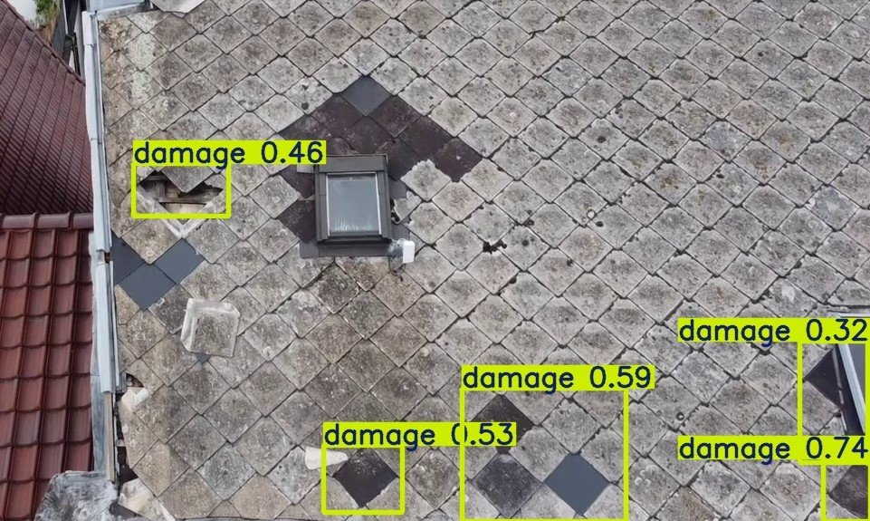
  <br><sub>Real output from the field test: a frame from the DJI Mini 2 livestream with YOLOv8 detections (confidence 0.32–0.74).</sub>
</p>

| What | Result |
|---|---|
| Pipeline | DJI Mini 2 → RTMP → MediaMTX → OpenCV → YOLOv8 → annotated live view |
| Dataset | 2,766 labelled images, 8 damage classes, augmented to **7,198** images |
| Models compared | YOLOv5s (7.0 M params) vs YOLOv8s (11.1 M params), 50 epochs each |
| Class imbalance | Custom SQRT-weighted sampler: recall on a varied test set **0.59 → 0.77** (YOLOv5s → YOLOv8s + SQRT) |
| GPU inference (live test) | **~23.9 ms** per frame on average, **40–45 FPS** |
| CPU inference (live test) | ~123.7 ms per frame, ~8 FPS |
| End-to-end latency (GPU) | **~520–540 ms** from drone camera to detection |
| Explainability | EigenCAM heatmaps via YOLOv8_Explainer |

> **Read the full thesis:** [thesis/StokmansBasBP.pdf](thesis/StokmansBasBP.pdf) (80 pages)
>
> *De bachelorproef zelf is in het Nederlands geschreven: "Een Open-Source Benadering voor Dakschadedetectie met Drones: Proof of Concept voor Kleine Zelfstandige Dakwerkers". Deze README is een Engelstalige samenvatting.*

---

## Contents

1. [The problem](#1-the-problem)
2. [How the system works](#2-how-the-system-works)
3. [Methodology](#3-methodology)
4. [Dataset and class imbalance](#4-dataset-and-class-imbalance)
5. [Model development: YOLOv5s vs YOLOv8s](#5-model-development-yolov5s-vs-yolov8s)
6. [Fixing the imbalance: SQRT-weighted sampling](#6-fixing-the-imbalance-sqrt-weighted-sampling)
7. [Results](#7-results)
8. [Explainability with EigenCAM](#8-explainability-with-eigencam)
9. [Live streaming: why RTMP](#9-live-streaming-why-rtmp)
10. [Field test](#10-field-test)
11. [Goals vs. what was reached](#11-goals-vs-what-was-reached)
12. [Limitations and future work](#12-limitations-and-future-work)
13. [What I learned](#13-what-i-learned)
14. [Repository contents](#14-repository-contents)
15. [Author and license](#15-author-and-license)

---

## 1. The problem

Roof inspections are dangerous. According to CPWR, falls from roofs caused 36.4% of fatal accidents in US construction in 2020. Drones remove the need to climb on the roof, but the footage is still reviewed by hand *after* the flight. When something suspicious shows up in the recordings, the inspector has to go back for a second flight.

Small independent roofers are the target group: they can buy a consumer drone, but not an expensive commercial inspection platform.

**Research question** (translated from Dutch):

> How can a real-time roof damage detection system be built that uses drone footage and YOLO object detection on a portable computer, with the best balance between processing speed and detection accuracy?

Sub-questions covered which YOLO version (v4–v9) fits a gaming laptop, which streaming protocol gives the lowest latency, which preprocessing helps, and how to detect specific damage types with few false positives and false negatives.

## 2. How the system works

The drone only films. All AI processing runs on a laptop, so the drone can stay cheap and unmodified.

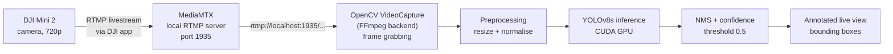

The detection loop described in the thesis (chapter 6):

1. **Stream initialisation**: open the stream with `cv2.VideoCapture('rtmp://localhost:1935/mystream')`
2. **Frame extraction**: read each frame from the stream
3. **Preprocessing**: resize and normalise the frame for the model
4. **Inference**: run the trained YOLOv8 model
5. **Post-processing**: Non-Maximum Suppression and a confidence threshold of 0.5 to limit false positives
6. **Display**: draw bounding boxes on the live view

<p align="center">
  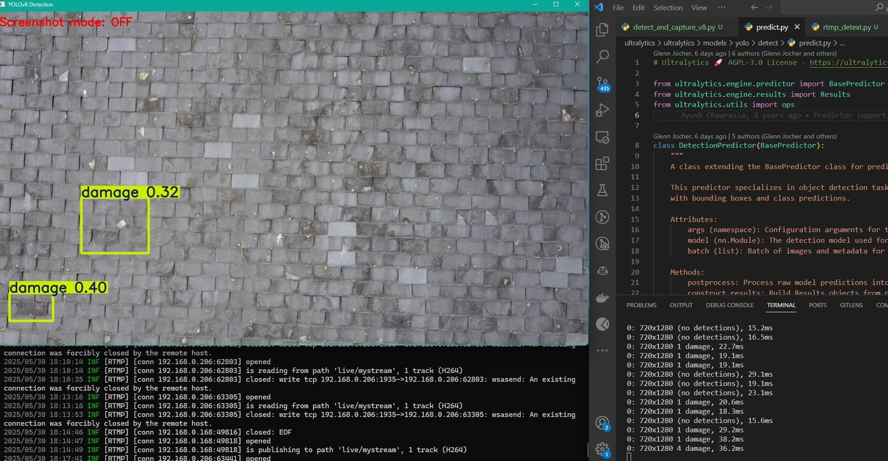
  <br><sub>The full pipeline running during the field test: the YOLOv8 detection window (left), the MediaMTX log showing the drone publishing an H.264 track over RTMP (bottom), and per-frame inference times on 720×1280 frames (right).</sub>
</p>

| DJI Mini 2 | DJI livestream settings | MediaMTX server |
|---|---|---|
| 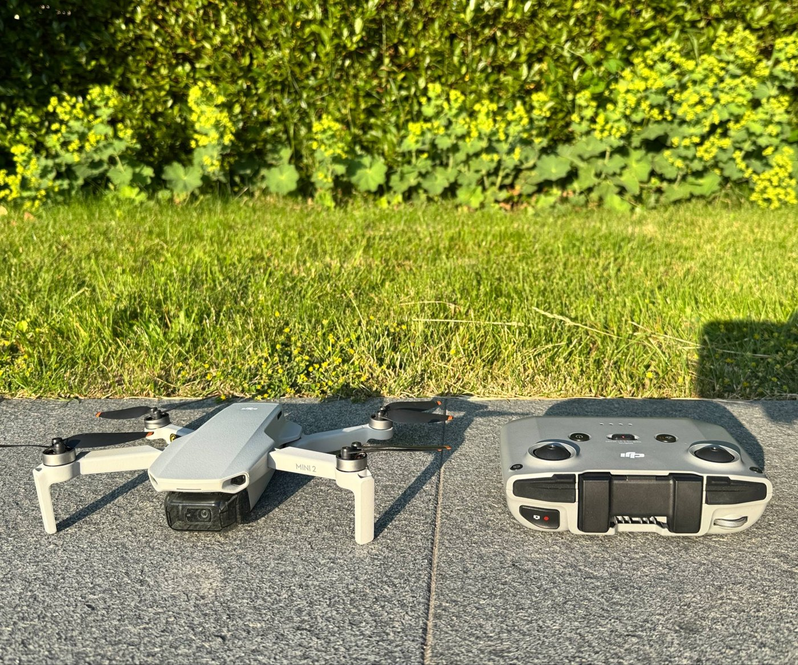 | 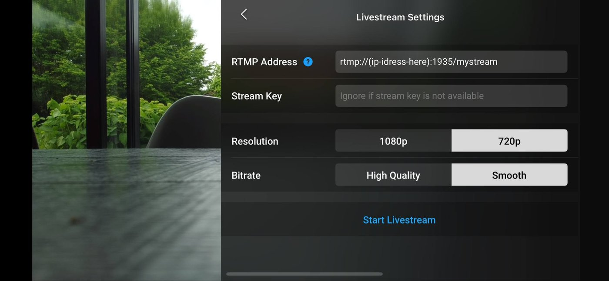 | 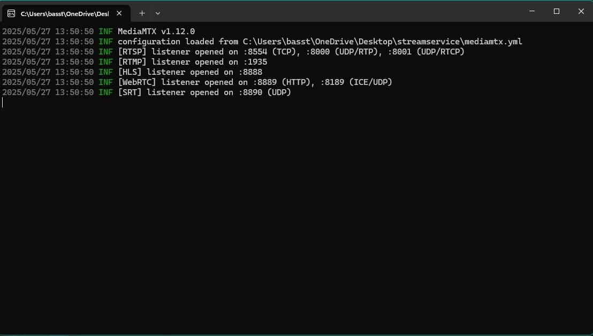 |
| The drone used for all tests. | RTMP address pointing to the laptop, 720p, "Smooth" bitrate. | MediaMTX with RTSP on 8554, RTMP on 1935 and WebRTC on 8889. |

## 3. Methodology

The research was split into six consecutive phases.

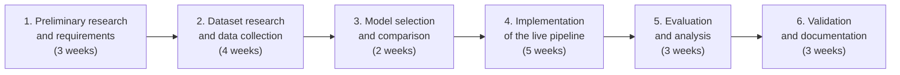

| Phase | What I did |
|---|---|
| 1. Preliminary research | Literature study of YOLOv4 to YOLOv9, open-source tooling, drone hardware limits, and streaming options (RTSP, WebRTC, GStreamer, RTMP). |
| 2. Dataset | Evaluated open datasets (rooftop/solar, disaster damage, xView, DOTA, Roboflow). Only Roboflow had roof-damage-specific data; merged two Roboflow datasets with extra images and labelled everything. |
| 3. Model selection | Trained YOLOv5s and YOLOv8s on the same data, compared precision, recall and speed, added SQRT balancing and tested confidence thresholds. |
| 4. Implementation | Python application with OpenCV, PyTorch/Ultralytics and MediaMTX for the RTMP stream. |
| 5. Evaluation | Precision/recall/mAP, latency and frame rate of the stream, CPU vs GPU, field tests on real roofs. |
| 6. Validation | Cross-checking results, documentation and a look at commercial feasibility. |

## 4. Dataset and class imbalance

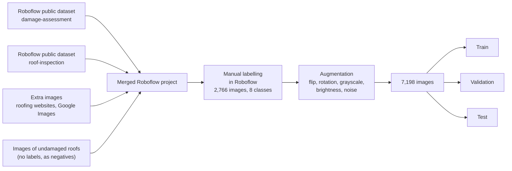

The focus was bitumen (asphalt) roof shingles, a common roof covering that is sensitive to weather and wear.

<p align="center">
  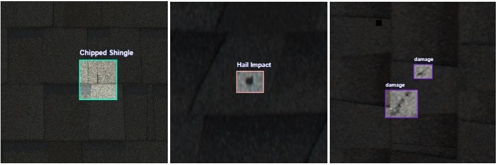
  <br><sub>Damage types in the dataset: (a) Chipped Shingle, (b) Hail Impact, (c) general damage. Images from the merged public Roboflow datasets, as used in the thesis.</sub>
</p>

**Labelling strategy.** I labelled every image by hand in Roboflow. When I was not sure about the exact type, I used the general `damage` label and only picked a subclass (like `Cracked Shingle` or `Puncture`) when the damage was clearly recognisable. This was a deliberate choice: first teach the model to find damage reliably, then add subtypes as a proof of concept. The downside is a strongly imbalanced dataset:

| Class | Labels |
|---|---:|
| damage | 4,353 |
| Hail Impact | 2,286 |
| Puncture | 1,337 |
| Dragons Tooth | 586 |
| Chipped Shingle | 350 |
| Cracked Shingle | 301 |
| Degranulation | 230 |
| Big-Damage | 67 |

<p align="center">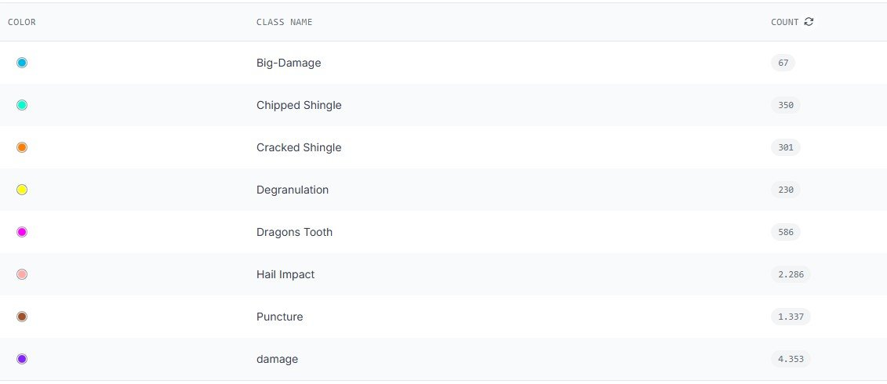</p>

**Augmentation (Roboflow):** horizontal flip, rotation between -20° and +20° (changing camera angles), 15% grayscale (poor colour information), brightness ±15% (sun, clouds, shadow), and noise up to 0.1% (compression and motion blur). This grew the dataset from 2,766 to 7,198 images.

The raw dataset is not included in this repository (it contains third-party images).

## 5. Model development: YOLOv5s vs YOLOv8s

Both models were trained in Google Colab for 50 epochs on the same merged dataset, starting from the pretrained `yolov5s.pt` and `yolov8s.pt` checkpoints.

| | YOLOv5s | YOLOv8s |
|---|---|---|
| Layers / parameters | 157 layers, ~7.0 M | 72 layers (fused), ~11.1 M |
| Training settings | 50 epochs, 640 px, batch 16, patience 25 | 50 epochs, 800 px, patience 25 |
| Validation precision | 0.312 | 0.333 |
| Validation recall | 0.621 | 0.651 |
| Validation mAP@0.5 | 0.322 | 0.336 |
| Validation mAP@0.5:0.95 | 0.151 | 0.178 |
| Speed (Colab Tesla T4) | — | 0.6 ms pre, 7.0 ms inference, 6.3 ms post per image |

The training settings and validation numbers come from the training logs in [`code/notebooks/`](code/notebooks/); the thesis rounds them to "mAP ~0.32 vs ~0.34". YOLOv8s was more accurate *and* fast enough, and fits better with current tooling, so it became the main model.

| YOLOv5s training curves | YOLOv8s training curves |
|---|---|
| 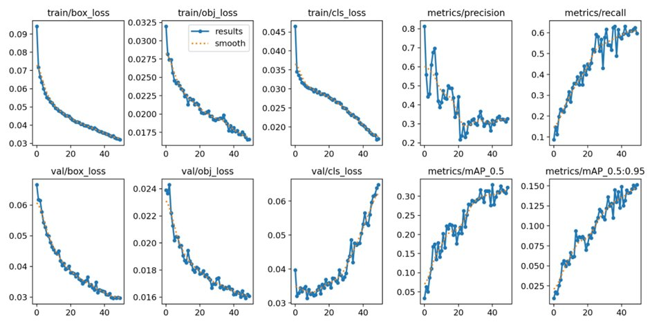 | 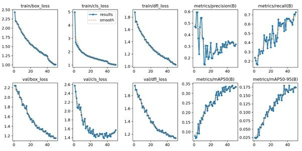 |

In both runs `val/cls_loss` starts rising again after about epoch 30, an early sign of overfitting on the imbalanced data. YOLOv8 reached a higher final recall (> 0.7 at its best epochs).

## 6. Fixing the imbalance: SQRT-weighted sampling

With this much imbalance, a model gets very good at `damage` and `Hail Impact` and largely ignores `Big-Damage` or `Degranulation`. Instead of changing the loss function or throwing data away, I changed **which images the model sees**.

I wrote a `YOLOWeightedDataset` that subclasses Ultralytics' `YOLODataset` (based on Yasin, 2024) and swapped it into the training pipeline:

1. Count the annotations per class.
2. Give each class a weight `w_c = sqrt(N_total / N_c)`, normalised to a mean of 1.
3. Give each image the mean weight of the classes it contains (empty images get weight 1).
4. During training, draw images with `np.random.choice(..., p=probabilities)` instead of in order. Validation is unchanged.

A weighted sampler was chosen over loss weights or undersampling because it is simpler to implement, keeps every training image, and gives smoother gradients because rare classes show up regularly.

Why the square root? In early tests, full inverse-frequency weighting made training unstable and overfit on the smallest classes, while milder methods barely changed anything. The square root sits in between.

```python
def calculate_sqrt_weights(self):
    total_samples = np.sum(self.counts)
    weights = np.sqrt(total_samples / self.counts)   # less aggressive than inverse
    return weights / np.mean(weights)                 # normalise to mean = 1

def __getitem__(self, index):
    if not self.train_mode:
        return self.transforms(self.get_image_and_label(index))
    weighted_index = np.random.choice(len(self.labels), p=self.probabilities)
    return self.transforms(self.get_image_and_label(weighted_index))
```

Full code: [`code/weighted_dataset_sqrt.py`](code/weighted_dataset_sqrt.py). The training notebook also contains a later "smart" variant ([`code/weighted_dataset_smart.py`](code/weighted_dataset_smart.py)) that uses the same SQRT base but caps or protects specific classes.

**Effect on what the model sees** (total times each class was shown in 43 epochs, normal vs weighted):

<p align="center">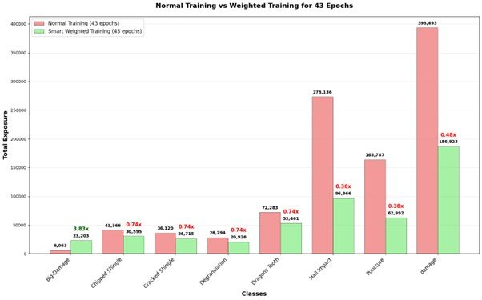</p>

- `Big-Damage` was shown **3.83×** more often.
- `damage` (0.48×), `Puncture` (0.38×) and `Hail Impact` (0.36×) were shown less often.
- `Chipped Shingle`, `Cracked Shingle`, `Degranulation` and `Dragons Tooth` were moderately rebalanced (~0.74×).

<p align="center">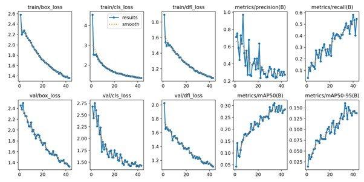</p>

## 7. Results

The models were tested on two image sets that were not used for training. These evaluations are **image-level**: an image counts as "damage present" if the ground truth has at least one box, and as "detected" if the model's highest confidence passes the threshold (see the evaluation notebooks). Precision, recall and accuracy below are about that yes/no question.

### External test set (hard: extreme zoom, shadows, feet in the frame)

| Model | Confusion matrix | Precision | Recall | Accuracy |
|---|---|---:|---:|---:|
| YOLOv5s | [[7 3], [116 51]] | 0.94 | 0.31 | 0.33 |
| YOLOv8s | [[9 1], [119 48]] | **0.98** | 0.29 | 0.32 |
| YOLOv8s + SQRT | see figure | 0.95* | 0.22 | 0.25 |

<sub>* Precision for the SQRT model is taken from the evaluation notebook output; the thesis reports its recall and accuracy.</sub>

| YOLOv5s | YOLOv8s | YOLOv8s + SQRT |
|---|---|---|
| 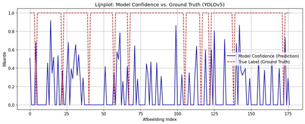 | 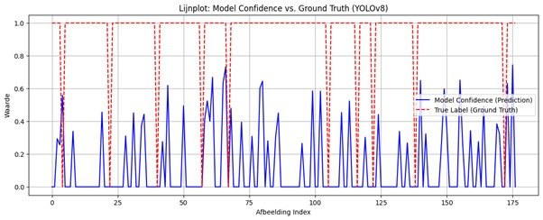 | 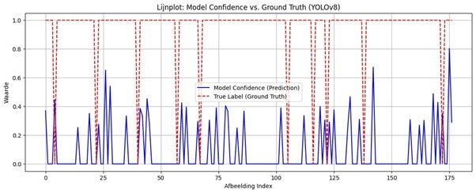 |

**The precision vs recall lesson.** YOLOv8 was right 98% of the time *when* it said "damage", but it found less than a third of the damaged images. For an inspection tool that is the wrong trade-off: a missed defect is worse than a false alarm the roofer can check. A high precision number alone can hide that.

### Varied test set (broader selection of roof damage images)

| Model | Confusion matrix | Precision | Recall | Accuracy |
|---|---|---:|---:|---:|
| YOLOv5s | [[0, 0], [52, 74]] | 1.00 | 0.59 | 0.59 |
| YOLOv8s | [[0, 0], [43, 83]] | 1.00 | 0.66 | 0.66 |
| YOLOv8s + SQRT | [[0, 0], [29, 97]] | 1.00 | **0.77** | **0.77** |

Every image in this set contains damage, so precision is 1.00 by construction; recall is the number that matters. Going from YOLOv5s to YOLOv8s raised recall from 0.59 to 0.66, and SQRT balancing raised it further to 0.77, about 30% better than the YOLOv5s baseline.

| YOLOv5s | YOLOv8s | YOLOv8s + SQRT |
|---|---|---|
| 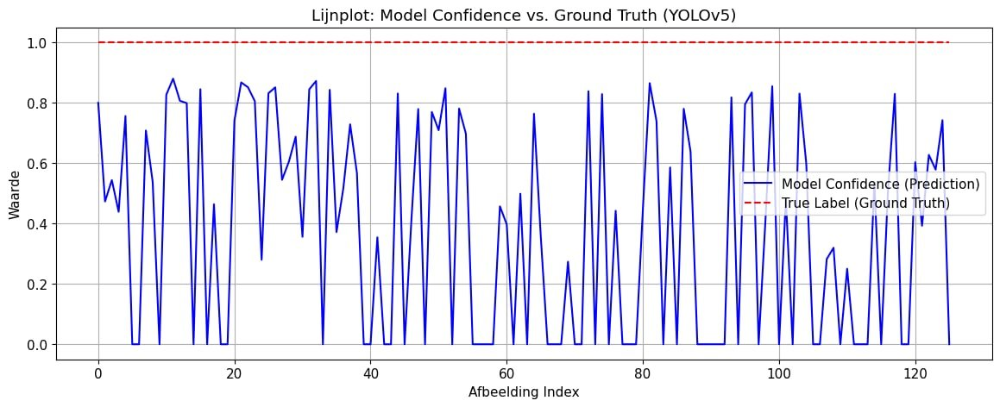 | 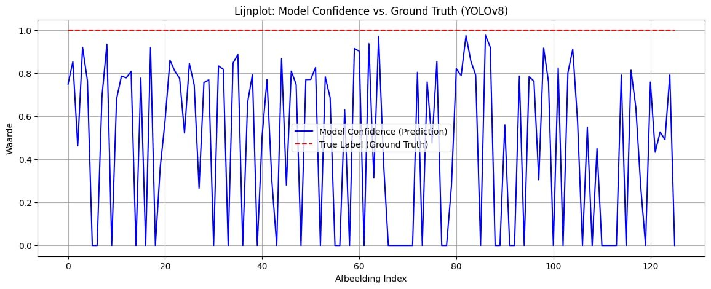 | 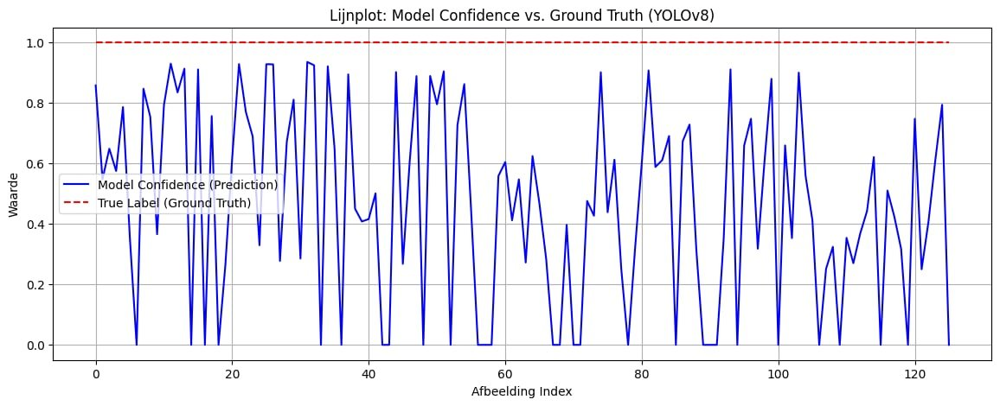 |

**Trade-off of balancing.** On the external set, which is still dominated by plain `damage`, the balanced model scores lower, because it no longer over-focuses on the most common class. On the varied set it is clearly the best. I chose the balanced model because, for a full roof assessment, every damage type matters regardless of how often it appears in the training data.

## 8. Explainability with EigenCAM

Metrics do not tell you *why* a model fires. I used the open-source [YOLOv8_Explainer](https://github.com/Spritan/YOLOv8_Explainer) package with **EigenCAM**, which shows the main activation pattern independent of the class label. That made it easy to see whether the model looked at the damage or at something irrelevant.

```python
from YOLOv8_Explainer import yolov8_heatmap, display_images

model = yolov8_heatmap(
    weight="/location/model.pt",
    conf_threshold=0.4,
    method="EigenCAM",
    layer=[10, 12, 14, 16, 18, -3],
    ratio=0.02,
    show_box=True,
    renormalize=False,
)
display_images(model(img_path="/location/image.jpg"))
```

| | Correct detection | Missed detection |
|---|---|---|
| **YOLOv5s** | 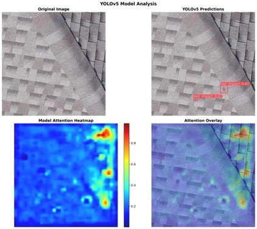<br><sub>Hail Impact found (0.67, 0.61); heat sits on the damage.</sub> | 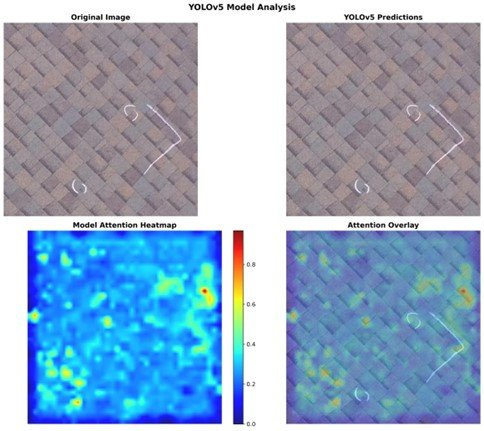<br><sub>No prediction; activation is scattered and partly on the inspectors' white chalk marks.</sub> |
| **YOLOv8s** | 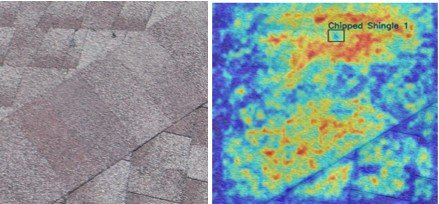<br><sub>Attention on the damaged zone.</sub> | 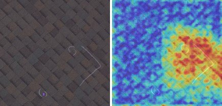<br><sub>Missed, but attention is already near the correct box.</sub> |
| **YOLOv8s + SQRT** | 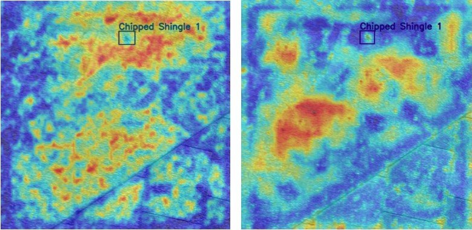<br><sub>Chipped Shingle detected with a clear hotspot.</sub> | 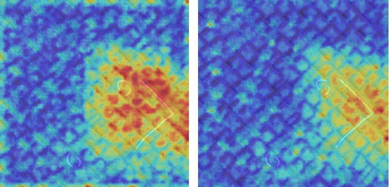<br><sub>No box, but a warm zone on the damage: probably just under the confidence threshold.</sub> |

<sub>Heatmaps are drawn over images from the public Roboflow datasets used for testing.</sub>

The heatmaps confirmed the numbers: the unbalanced YOLOv5 model was distracted by chalk marks, and the balanced YOLOv8 model focused more consistently on actual damage.

## 9. Live streaming: why RTMP

The literature study compared four ways to get the drone feed onto the laptop:

| Protocol | What the literature says |
|---|---|
| RTSP | Common for IP cameras and local networks; under 500 ms possible with the right configuration. |
| WebRTC | Peer-to-peer with very low delay (under 500 ms), encryption and adaptive bitrate, but needs a signalling server, NAT traversal (STUN/TURN) and a media encoder. |
| GStreamer | Low-level pipelines with full control over encoders and buffers; under 100 ms technically possible, but highly dependent on hardware and configuration. |
| **RTMP** | Runs over TCP. In tests by Aloman et al. (2015) it gave better perceived quality than RTSP under packet loss and delay. |

**RTMP was chosen** because it offers stable transfer over TCP, the DJI app can publish to an RTMP address directly, and it integrates well with OpenCV and PyTorch. A local MediaMTX server on the laptop receives the stream, and the detection script reads it from `localhost`. The trade-off is latency: RTMP buffering accounts for most of the delay (see below).

<p align="center">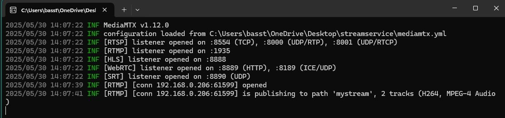</p>

## 10. Field test

The complete system was tested on real roofs, made possible by my co-supervisor at Stad Mechelen. The goal was not perfect scores but finding the real problems.

| Detections on tiles / slate (confidence 0.31–0.74) | Subtle degranulation (0.35–0.38) |
|---|---|
|  | 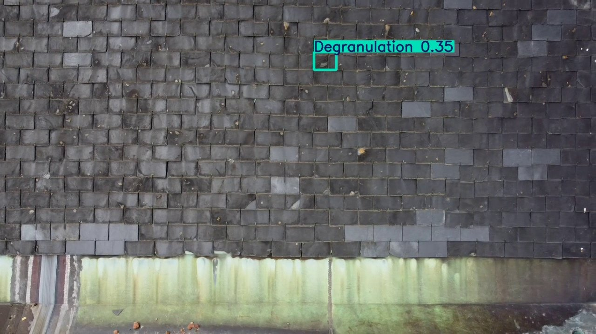 |

### Measured stream latency

| Time on the clock (filmed) | Time received | Latency |
|---|---|---:|
| 17:15:39 | 17:15:39.804 | ~804 ms |
| 17:16:15 | 17:16:15.185 | ~185 ms |
| 17:16:15 | 17:16:15.449 | ~449 ms |
| 17:17:11 | 17:17:11.714 | ~714 ms |

### CPU vs GPU

| Metric | CPU | GPU |
|---|---:|---:|
| Average inference time | 123.7 ms | ~23.9 ms |
| Fastest frame | 107.9 ms | 10.8 ms |
| Slowest frame | 156.3 ms | 37.0 ms |
| Estimated FPS | ~8 | 40–45 |
| Total latency (RTMP + inference) | ~600–700 ms | ~520–540 ms |

The GPU cut inference time by about 80%. With roughly 500 ms of RTMP latency plus ~24 ms of inference, the delay between reality and detection was about half a second, fast enough to react during the same flight.

### What went wrong (and why it matters)

- **Material mismatch.** The model was trained mostly on asphalt shingles but tested on roof tiles and slate. That explains most of the spread in confidence (0.31–0.64 on these roofs). It still found damage on a material it had never seen, which shows some generalisation, but it also shows how much the training data has to match the target roofs.
- **720p stream.** Small cracks and impacts that are visible in full-resolution photos disappear in the compressed livestream.
- **Flight height.** Too high gives too little detail; too low causes instability and motion blur.
- **Weather and light.** Wind shook the camera, and changing light changed the detection results between consecutive frames.

## 11. Goals vs. what was reached

| Goal set in the proposal | Outcome |
|---|---|
| End-to-end latency of at most 1 second | Reached: ~520–540 ms on GPU (~600–700 ms on CPU). |
| At least 15 FPS at 640×640 on a gaming laptop | Reached: 40–45 FPS on GPU. |
| At least three damage types detectable | Eight classes trained; specific subtypes remain proof-of-concept quality. |
| mAP of at least 75% | **Not reached**: validation mAP@0.5 was ~0.34. The dataset size and imbalance were the limiting factor. |
| Interface that shows detections live | A live OpenCV window with bounding boxes; a full user-facing application is future work. |

## 12. Limitations and future work

- **More diverse data.** Add roof tiles, slate, metal roofs and different weather, seasons and light, ideally with real inspection reports from roofing companies and municipalities.
- **Patch-based inference (SAHI).** Slicing Aided Hyper Inference splits high-resolution frames into overlapping patches, which the SAHI authors report raises AP by 5.1–6.8% with sliced inference alone and by up to 14.5% combined with sliced fine-tuning. A "deep scan" button could run it on a snapshot when the live model is unsure.
- **Streaming.** WebRTC or a tuned GStreamer pipeline could bring latency under 300 ms.
- **User interface.** A guided inspection app with automatic reports and integration with roofer software.
- **Pilots.** Test with small roofing companies; an open-source model could help adoption.

## 13. What I learned

- **Precision can hide danger.** A model that is almost always right when it fires can still miss most real damage. For inspection, recall matters most.
- **Data decisions shape the model.** My "label `damage` when unsure" rule made detection easier to learn but created the imbalance I later had to fix.
- **Fix imbalance where it is cheapest.** Rebalancing the sampler instead of the loss kept the training setup simple and kept every image in the dataset.
- **A notebook is not a system.** Streaming, buffering, ports, codecs and latency took as much work as the model, and latency has to be measured end to end, not just as inference time.
- **Look inside the model.** EigenCAM showed problems (chalk marks, shadows) that no metric would have pointed out.
- This was outside my own specialisation (Mobile & Web Development). I had tried YOLO before, but this project was my chance to learn object detection, training and evaluation in depth.

## 14. Repository contents

```
drone-roof-damage-detection/
├── README.md
├── LICENSE.md
├── thesis/
│   └── StokmansBasBP.pdf              full thesis (Dutch, 80 pages)
├── docs/images/                       figures from the thesis
├── code/
│   ├── README.md
│   ├── weighted_dataset_sqrt.py       SQRT-weighted sampler (thesis version)
│   ├── weighted_dataset_smart.py      later variant with per-class caps
│   ├── thesis-listings/               the code listings printed in the thesis
│   └── notebooks/                     the original Colab notebooks (cleaned)
└── models/
    └── README.md                      about the trained weights
```

- **Code:** the training and evaluation notebooks are the real Colab notebooks I used, with large image outputs removed and the Roboflow API key replaced by a placeholder. See [`code/README.md`](code/README.md).
- **Not included:** the live RTMP detection script (I could not recover the file), the raw dataset (third-party images) and the trained weights (see [`models/README.md`](models/README.md)).

## 15. Author and license

**Bas Stokmans** · [basstokmans.com](https://basstokmans.com)

Bachelor thesis, Professional Bachelor in Applied Computer Science, HOGENT, academic year 2024–2025.
Supervisor: Mr. S. De Gheselle · Co-supervisor: Mr. P. Zeeuws (Stad Mechelen).

My own text, figures and code are licensed under [CC BY 4.0](LICENSE.md). Third-party material (public Roboflow dataset images, the Ultralytics and YOLOv8_Explainer libraries, the Roboflow notebook template) stays under its own license; see [LICENSE.md](LICENSE.md).
